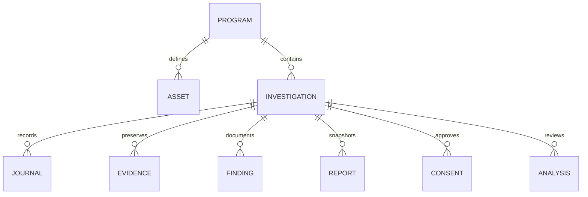

# Arquitetura

## Componentes

- `frontend/`: React 19, TypeScript, Vite, Tailwind e Button no padrão shadcn/ui. Dialog utiliza Radix para foco, teclado e leitor de tela. Navegação em estado local, sem autenticação ou persistência de conteúdo no navegador.
- `backend/main.py`: fábrica FastAPI, validação de limites e referências e rotas locais.
- `backend/models.py` e `schemas.py`: persistência SQLAlchemy e contratos Pydantic, com rejeição de campos desconhecidos.
- `backend/scope.py`: normalização offline, correspondência exata e wildcard, negação prioritária.
- `backend/storage.py`: nomes internos aleatórios, limites, SHA-256 e leitura restrita ao cofre.
- `backend/ai.py`: fronteira dos provedores, prévia, redação, instruções de dados não confiáveis e execução aprovada. Endpoints fixos; proxies do ambiente e redirects desabilitados.
- `backend/reports.py`: snapshots determinísticos e PDF sem HTML externo, recursos remotos ou execução de conteúdo importado.
- `migrations/`: schema inicial congelado. Não utiliza `create_all` como substituto de migrations.

## Modelo relacional

Todos os IDs são UUID. Datas são UTC ISO-8601; a interface as mostra no fuso do navegador. Valores de recompensa são inteiros em centavos e moeda ISO de três letras, sem somar moedas diferentes. Vínculos de evidências dos achados são listas JSON, validadas no serviço para impedir referências entre investigações. Remoção de evidência vinculada é bloqueada. Chaves estrangeiras e cascatas estão habilitadas em cada conexão SQLite.

## Armazenamento e concorrência

O padrão é `~/.caspar/caspar.sqlite3`, `evidence/<uuid>.bin` e `backups/<uuid>.zip`. Relatórios ficam como snapshots de texto no banco e são materializados sob demanda no download; a pasta `reports/` é reservada para evolução. O diretório não pode ser a raiz de volume, a pasta home inteira ou estar dentro do repositório.

O backend usa uma fila de exclusão mútua para requisições da API, garantindo que mutações não concorram com a cópia de banco e arquivos do backup dentro de uma instância. SQLite usa `foreign_keys`, `busy_timeout` e `secure_delete`. Não inicie múltiplos workers, servidores ou comandos de escrita CLI sobre o mesmo diretório ao mesmo tempo. Análise de IA bloqueia outras operações da API por até o timeout do provedor nesta versão.

Banco e filesystem não compartilham transação. Falhas ordinárias de upload revertem a linha e removem o arquivo parcial. Uma queda abrupta entre escrita de arquivo e commit pode deixar arquivo órfão; uma queda entre commit de exclusão e unlink pode deixar arquivo sem metadados. Faça backup antes de manutenção; a exclusão total remove arquivos remanescentes nas pastas controladas.

## Fronteira da IA

1. Usuário seleciona IDs da investigação e uma pergunta.
2. Backend confere escopo e integridade, lê apenas os arquivos selecionados e aplica redação.
3. Prévia é salva localmente com digest, provedor, modelo e validade; nada é enviado.
4. Usuário aprova explicitamente o digest, com checkbox inicialmente desmarcado.
5. Backend verifica referências e integridade novamente, consome a aprovação antes da chamada e não repete a tentativa.
6. Somente o endpoint fixo do provedor recebe o payload aprovado e instruções fixas. A cópia do payload de aprovação é apagada após a tentativa.
7. Resposta exige três seções distintas, é tratada como não confiável e não altera achados. Ausência de seções descarta o resultado.

## Rotas principais

Todas as rotas de dados exigem `X-Caspar-Local: 1`. O frontend usa a mesma origem. `/api/health` retorna apenas saúde, edição e ausência de scanning. A documentação interativa pública está desabilitada.

| Método e caminho | Função |
| --- | --- |
| `GET /api/workspace` | Registros do workspace, sem tokens de aprovação |
| `POST /api/programs` / `PUT /api/programs/{id}` | Cadastro/atualização de autorização e política |
| `POST /api/programs/{id}/assets` | Regra explícita de permissão ou proibição |
| `POST /api/programs/{id}/scope-check` | Decisão offline, sem DNS |
| `POST /api/programs/{id}/investigations` | Criar investigação após Scope Guard |
| `POST /api/investigations/{id}/journals` | Registrar diário |
| `POST /api/investigations/{id}/evidence` | Importação multipart com origem |
| `GET /api/evidence/{id}/download` | Download inerte, com integridade conferida |
| `POST /api/investigations/{id}/findings` / `PUT /api/findings/{id}` | Achado e acompanhamento manual |
| `POST /api/investigations/{id}/reports` | Snapshot PT/EN |
| `GET /api/reports/{id}/download?format=md\|pdf` | Exportar laudo |
| `POST /api/investigations/{id}/ai/preview` / `ai/analyze` | Prévia local / envio aprovado |
| `GET /api/export` / `POST /api/backup` | Exportação JSON / backup ZIP |
| `DELETE /api/data` | Exclusão com confirmação literal |

Há ainda exclusões unitárias de programa, investigação, ativo e evidência. Diários são registros anexados; a versão inicial não oferece edição/exclusão isolada de cada nota. Excluir sua investigação remove todo o contexto.

## Evolução do schema

Com uma cópia de desenvolvimento do banco e o backend parado, use `python -m alembic revision --autogenerate -m "descricao"`. Revise o arquivo gerado antes de `python -m alembic upgrade head`. Mudanças SQLite podem exigir `op.batch_alter_table`. Faça backup antes de atualizar; downgrade não é um substituto de restauração, especialmente se remover dados.
